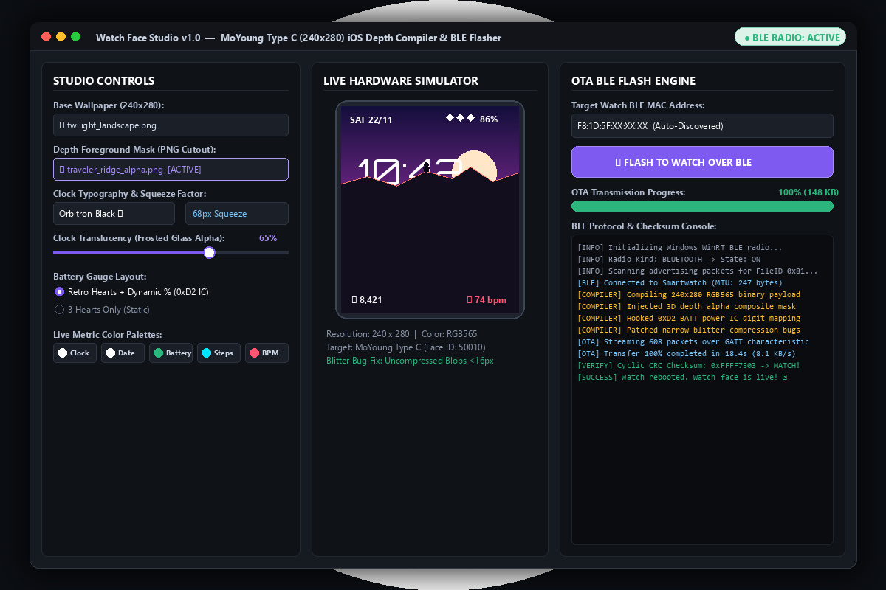

# ⌚ Watch Face Studio

A Python-based smartwatch customization project for designing,
compiling, simulating, and deploying custom watch faces to compatible
MoYoung Type C smartwatches with a 240×280 display.

The project explores custom visual composition, firmware binary
generation, RGB565 image processing, and Bluetooth Low Energy (BLE)
communication through a desktop application.

------------------------------------------------------------------------

## 📸 Project Showcase

### 1. Smartwatch Depth Effect


An iOS-inspired depth-effect clock design with a foreground portrait
mask, retro gaming-inspired health hearts, and a dynamic battery
percentage display.

### 2. Watch Face Studio --- Desktop Application



The desktop interface brings together watch face controls, a live
240×280 simulator, and the BLE flashing console.

### 3. Engineering Pipeline Architecture


The project pipeline is organized into four stages:

1.  **Layered Visual Engine** --- Composes the wallpaper, typography,
    transparency, and foreground mask.
2.  **Firmware Binary Compiler** --- Generates the custom watch face
    binary and handles RGB565 image data.
3.  **OTA BLE Flasher** --- Communicates with the watch over Bluetooth
    Low Energy.
4.  **Hardware Execution** --- Runs the deployed watch face on the
    target smartwatch.

------------------------------------------------------------------------

## ✨ Key Features

-   **Custom watch face composition:** Combines background images,
    typography, alpha masks, and layered visual elements.
-   **3D depth-style clock:** Places clock typography behind a
    foreground subject using a cutout mask.
-   **Live hardware simulator:** Previews the design at 240×280
    resolution.
-   **RGB565 image processing:** Converts image data into a format
    suitable for the target display pipeline.
-   **Firmware binary generation:** Builds watch face `.bin` payloads
    for the target format.
-   **BLE deployment workflow:** Provides a desktop interface for
    wireless watch face transfer.
-   **Customizable appearance:** Includes controls for typography,
    squeeze factor, opacity, and battery gauge layout.
-   **Hardware metrics display:** The showcased design includes date,
    battery, steps, and BPM indicators.

## 🧰 Technology Stack

  Area                   Technologies
  ---------------------- --------------------------------
  Programming language   Python
  Image processing       Pillow (PIL), NumPy
  Bluetooth Low Energy   Bleak, Windows WinRT Bluetooth
  Display image format   RGB565
  Desktop interface      Python GUI
  Firmware output        Custom `.bin` generation

## 🏗️ System Architecture

``` text
Wallpaper + Foreground Mask
            │
            ▼
    Layered Visual Engine
            │
            ▼
   Firmware Binary Compiler
            │
            ▼
      Custom .bin Payload
            │
            ▼
       OTA BLE Flasher
            │
            ▼
      Smartwatch Hardware
            │
            ▼
       Custom Watch Face
```

## ⚙️ Project Capabilities

### Visual composition

-   240×280 base wallpaper handling.
-   Foreground PNG alpha-mask composition.
-   Custom font rendering and vertical typography adjustment.
-   Frosted-glass-style clock transparency.
-   Retro 8-bit-inspired heart gauge.

### Firmware compilation

-   Custom binary structure handling for the target watch face format.
-   RGB565 pixel packing.
-   File and face-number mapping.
-   Handling of narrow sprite rendering issues.

### Bluetooth deployment

-   Windows Bluetooth radio interaction.
-   BLE device discovery and connection.
-   GATT-based chunked data transfer.
-   Transfer progress and checksum verification workflow.

> **Compatibility note:** This project targets the MoYoung Type C watch
> face format shown in the development setup. Compatibility with other
> smartwatch models and firmware versions has not been established.

## 🚀 Getting Started

### Prerequisites

-   Windows PC with Bluetooth support.
-   Python 3.x.
-   A compatible MoYoung Type C smartwatch.
-   Required Python packages used by the project.

### Installation

Clone the repository:

``` bash
git clone https://github.com/YOUR-USERNAME/Watch-Face-Studio.git
cd Watch-Face-Studio
```

Create and activate a virtual environment:

``` bash
python -m venv .venv
.venv\Scripts\activate
```

Install dependencies:

``` bash
pip install -r requirements.txt
```

Run the application using the project's entry-point script:

``` bash
python watch_face_studio.py
```

> Adjust the entry-point filename or installation commands if your
> repository uses a different setup. A `requirements.txt` should be
> included with the project's actual dependencies.

## 📁 Suggested Repository Structure

``` text
Watch-Face-Studio/
│
├── watch_face_studio.py
├── requirements.txt
├── README.md
│
├── 1_Smartwatch_Depth_Effect_Showcase.png
├── 2_Watch_Face_Studio_App_UI.png
└── 3_Engineering_Pipeline_Architecture.png
```

Keep the three showcase PNG files in the repository root, or update the
image paths in this README if you place them in a separate folder.

## 🔬 Project Focus

This project is an exploration of:

-   Python application development
-   Embedded systems and smartwatch customization
-   Firmware analysis and binary data handling
-   Image processing and pixel formats
-   Bluetooth Low Energy communication
-   Hardware and software integration

## ⚠️ Disclaimer

This is an independent smartwatch customization and reverse-engineering
project. It is not affiliated with or endorsed by the smartwatch
manufacturer.

Firmware modification and wireless flashing may carry a risk of device
malfunction. Use compatible firmware and hardware, and proceed
carefully.

## 📄 License

Add a license file before distributing or accepting contributions. The
repository's license should reflect the permissions you intend to grant.
